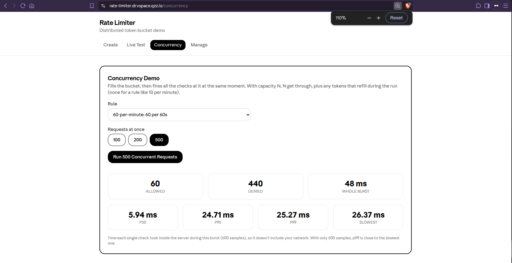
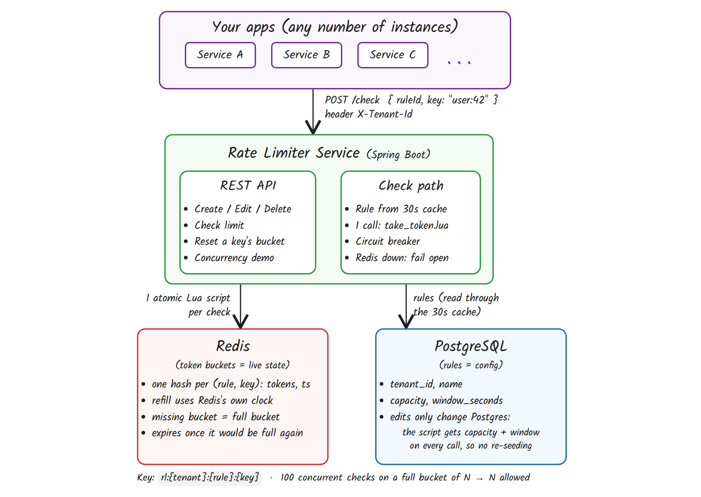

# Distributed Rate Limiter

A rate limiting service I built to learn how you keep a limit correct when lots of requests (and lots of app servers) hit it at the same time.

Your backend asks it something like "can `user:42` log in again?" and gets back yes or no, how many tries are left, and how long to wait. The counting happens inside Redis in a single Lua script, so it stays exact under concurrency, even with several copies of the service running.

Spring Boot + Redis + Postgres, with a small React page to play with it.

Live demo: https://rate-limiter.drvspace.qzz.io

<p align="center">
  
</p>

Some numbers, measured on the live server (a 2 vCPU AWS box it shares with three other apps):

- p99 of 5 ms at a steady 1,000 checks per second, across two separate runs
- fire 100, 200 or 500 checks at a full bucket at the same moment, and only as many get through as there are tokens: exactly 60 for a "60 per minute" rule, every run, even with two app instances sharing one Redis
- a burst of 100 simultaneous checks finishes in 15–30 ms, and 500 in about 70–90 ms

There's more on how I measured it, and where it stops keeping up, in [Performance](#performance).

## How it works

A **rule** is a limit like "60 requests per minute". Rules live in Postgres.

A **key** is whatever you're limiting: a user id, an API key, an IP. You send it with each check, so one rule covers all your users, and every (rule, key) pair gets its own **token bucket** in Redis.

The bucket holds up to `capacity` tokens and refills smoothly at `capacity / windowSeconds` tokens per second. Each request takes a token. No token left means the request is denied.

Reading the bucket, refilling it, taking a token and saving it all happen in one Lua script, [`take_token.lua`](src/main/resources/lua/take_token.lua). Redis runs a script start to finish before it runs anything else, so two requests can't both grab the last token.

<p align="center">
  
</p>

## Things I had to think about

**Race conditions.** If you `GET` the bucket, do the maths in Java and `SET` it back, two requests can both read "1 token left" and both get through. Doing it all in the Lua script fixes that. The integration test fires 100 checks at a bucket of 10 at the same moment and expects exactly 10 to pass.

**Whose clock.** The script reads the time from Redis (`TIME`) instead of the app server. If I run three app instances whose clocks are slightly off, they still agree on how much a bucket has refilled.

**Keeping Postgres out of the way.** Every check needs its rule, but going to Postgres every time would make the database the bottleneck. Rules are cached in memory for 30 seconds. The catch: with several instances, an edit or delete can take up to 30 seconds to reach the others. For rate limits I think that's fine.

**Editing a rule.** My first version refilled the bucket whenever a rule was edited, which handed out free tokens. Now the script gets the capacity and window on every call, so an edit only touches Postgres. Lowering the capacity caps buckets on their next check, and raising it doesn't refill anyone.

**No "create bucket" step.** A bucket that doesn't exist counts as full. Buckets expire once they'd be full again anyway, so Redis only holds buckets that are actually in use. Resetting one is just `DEL`.

**Redis running out of memory.** Redis runs with `noeviction`. With the usual LRU setting it would quietly drop buckets when memory got tight, which silently resets people's limits.

**Redis going down.** The Redis call goes through a Resilience4j circuit breaker. When Redis fails, or failed recently enough that the breaker is open, the fallback answers instead:
- fail open (the default) lets requests through;
- fail closed blocks them.

Either way the response says `"redisDown": true`. The Redis timeout is 300 ms, so a failing check takes at most about half a second, and once the breaker opens (3 failures) checks answer right away.

**The public demo.** The concurrency demo is open to anyone and fires up to 500 checks per run, so it's rate limited by the service itself: 10 runs a minute per IP, one run at a time.

## Tech stack

Backend:
- Java 17, Spring Boot 3.5 (Web, Data JPA, Data Redis, Validation)
- Redis 7 with a Lua script for the bucket logic
- PostgreSQL 16 for rules
- Resilience4j circuit breaker: watches the last 5 calls, opens once at least 3 have run and half of them failed, waits 5 s, then tries 2 calls
- Springdoc OpenAPI (Swagger UI)
- Maven; JUnit 5 + Testcontainers for tests

Frontend: React 18, TypeScript, Vite, Tailwind CSS, React Router.

Infra:
- Multi-stage Docker build (Node → Maven → JRE Alpine) running as a non-root user
- Docker Compose for app + Postgres + Redis, with memory limits (768M / 256M / 128M)
- Runs on an AWS EC2 t2.medium behind nginx and Cloudflare

## API

Every call needs an `X-Tenant-Id: <uuid>` header. There's no login in this project, so the header is just trusted; a real version would give each tenant an API key.

| Method | Path | What it does |
|---|---|---|
| GET | `/api/v1/limits` | List your rules |
| POST | `/api/v1/limits` | Create a rule: `{name, capacity, windowSeconds}` |
| PUT | `/api/v1/limits/{ruleId}` | Edit a rule |
| DELETE | `/api/v1/limits/{ruleId}` | Delete a rule (its buckets expire on their own) |
| POST | `/api/v1/limits/check` | The hot path: `{ruleId, key}`, takes a token if there is one |
| POST | `/api/v1/limits/{ruleId}/reset?key=` | Refill one key's bucket |

A check answers like this:

```json
{ "allowed": false, "remaining": 0, "retryAfterMs": 11805, "redisDown": false }
```

It returns 200 for both yes and no. The service only decides; your app sends its own 429 and can use `retryAfterMs` for `Retry-After`. Errors always look like `{"error": "..."}`, and Swagger is at `/swagger-ui.html`.

The demo page uses one more endpoint, `POST /demo/concurrency/{ruleId}?requests=100|200|500`. It refills the bucket, fires that many checks at it at once, and returns how many were allowed and denied, the time for the whole burst, and how long each check took (p50/p95/p99/max).

## Trying the demo

Open the [live demo](https://rate-limiter.drvspace.qzz.io). Your browser gets its own random tenant, so you only see your own rules.

1. **Create**: click "60 / min" (or 10, 100, 200, or fill in your own).
2. **Live Test**: pick the rule, send 1 request or 10 at once, and watch the tokens go down.
3. **Concurrency**: pick the rule, choose 100, 200 or 500 requests and run it. With "60 / min" you should get exactly 60 allowed. With "200 / min" and 500 requests you might see 201: one token refilled during the run, which is the bucket doing its job.
4. **Manage**: edit or delete rules.

The timings on the Concurrency page are measured inside the server, so they don't include your internet connection. The first couple of runs after a restart are slower while the JVM warms up.

## Running it yourself

```bash
docker compose up --build -d      # app on http://localhost:8082
mvn test                          # needs Docker, starts a real Postgres + Redis
```

Settings (environment variables in `docker-compose.yml`): `RATELIMITER_FAIL_OPEN` (default `true`) and `POSTGRES_PASSWORD` (default `ratelimiter`, fine for local use).

## Tests

[`RateLimiterTest`](src/test/java/com/ratelimiter/RateLimiterTest.java) runs the real Lua script against Redis and Postgres in Docker using Testcontainers. It checks that:
- 100 simultaneous checks against a bucket of 10 let exactly 10 through
- different keys get different buckets
- buckets refill over time and `retryAfterMs` is right
- lowering a rule's capacity caps the bucket, and raising it doesn't refill it
- bad requests get readable errors
- checks fail open when Redis is stopped

## Performance

Measured on the live server: an AWS t2.medium (2 vCPUs) that also runs three other apps. I used [k6](https://k6.io) on the same machine, calling the app directly, so internet latency isn't included. k6 was also competing with the app for the same 2 CPUs, so the real numbers are probably a bit better.

Each run sends checks at a fixed rate for 30 seconds, whether or not earlier ones have answered yet. That's stricter than keeping a fixed number of requests in flight, because a slowdown can't hide by also slowing down the load. Checks are spread across 1,000 users.

| Rate | p50 | p95 | p99 | max |
|---|---|---|---|---|
| 500/s | 0.6 ms | 1.4 ms | 3.0 ms | 35 ms |
| 1,000/s (two runs) | 0.8 ms | 2.1 ms | 5.1 ms | 23–32 ms |
| 1,200/s | 0.9 ms | 3.0 ms | 7.2 ms | 24 ms |
| 1,300/s | 1.0 ms | 3.5 ms | 7.7 ms | 37 ms |
| 1,500/s | 1.2 ms | 7.4 ms | 21.6 ms | 77 ms |
| 2,000/s | 2.0 ms | 14.1 ms | 35.3 ms | 178 ms |
| 2,500/s | 5.1 ms | 82.7 ms | 166 ms | 340 ms |

Nothing failed at any rate. Up to about 1,000/s it's comfortable. Around 1,100–1,300/s p99 hovers near 10 ms (one run at 1,100 went to 10.9 ms, so treat that range as the edge). Past that, requests start queueing for the CPUs and p99 climbs quickly. Each check is a single Redis round trip, so the limit here is the 2 vCPUs, not Redis.

The concurrency demo on the same box, warm, 16 runs against a "60 per minute" rule: exactly 60 allowed every time. A burst of 100 finished in 15–32 ms (each check p99 7–19 ms), and a burst of 500 in 66–94 ms. Those are mostly 100 or 500 threads taking turns on 2 CPUs; the Redis part of each check is well under a millisecond.

To run the same test yourself:

```bash
docker compose up -d
docker run --rm --network host -v "$PWD/bench:/b" -e RATE=1000 grafana/k6:0.54.0 run /b/check.js
```

The script is [`bench/check.js`](bench/check.js). It makes a throwaway rule, hammers it for 30 seconds, then deletes it.

## Code layout

Everything is in one package, `com.ratelimiter`:

| File | What's in it |
|---|---|
| `RuleController` | the API |
| `RuleService` | creating/editing rules, plus the 30 second cache |
| `Buckets` | calls the Lua script; the circuit breaker fallback |
| `DemoController` | the concurrency demo |
| `Errors` | turns exceptions into `{"error": "..."}` |
| `Rule`, `RuleRepository` | the Postgres table |
| `SpaConfig` | serves the React app |

The table is created by `schema.sql` when the app starts. The bucket logic is in `lua/take_token.lua`, and the React app is in `frontend/`.

## What I'd add next

- API keys per tenant instead of trusting a header
- Redis replication; right now it's one Redis, and fail-open/closed covers it being down
- Metrics: allowed/denied counts and Redis latency per rule
